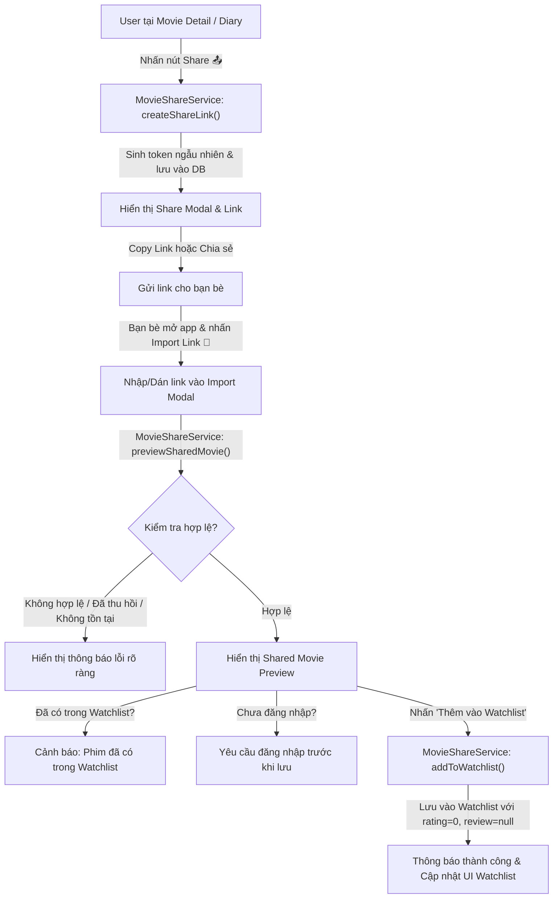

# 🎬 MOVIE SHARING & SOCIAL WATCHLIST DOCUMENTATION

## 1. Tổng quan tính năng (Feature Overview)

Tính năng **Movie Sharing & Social Watchlist** cho phép người dùng chia sẻ bất kỳ bộ phim nào từ Watch Diary (Nhật ký xem phim) cá nhân cho bạn bè thông qua một đường link duy nhất, bảo mật và an toàn.

Người nhận có thể:
- Mở hoặc dán đường link trực tiếp trong ứng dụng.
- Xem trước thông tin phim kèm đánh giá và nhận xét mang tính tham khảo từ người gửi.
- Thêm phim đó vào **Watchlist** cá nhân ở trạng thái *Want to Watch* (`isWatched: false`).

### Nguyên tắc thiết kế cốt lõi:
- **Zero Global Movie Catalog:** Ứng dụng không cần và không tạo một cơ sở dữ liệu phim toàn cầu để chia sẻ. Thông tin phim được đóng gói và lưu trữ an toàn trong bảng `shared_movies`.
- **Bảo toàn dữ liệu cá nhân (Data Isolation):**
  - Rating và review của người chia sẻ **chỉ mang tính tham khảo** cho bạn bè.
  - Khi người nhận thêm phim vào Watchlist, rating cá nhân luôn là `0.0` và review là `null`.
  - Không tự ý thêm phim vào Watchlist nếu người nhận chưa xác nhận.
- **Bảo mật Token:** Sử dụng token ngẫu nhiên, URL-safe sinh bởi `Random.secure()` (ví dụ `mov_...`), tuyệt đối không để lộ primary key / database ID.
- **Quyền kiểm soát (Revocation):** Người chia sẻ có thể thu hồi (revoke) link bất cứ lúc nào. Khi đã thu hồi, người nhận không thể import lại từ link cũ.

---

## 2. User Flow



---

## 3. Database Changes

### Migration lên `dbVersion = 3` trong [`DatabaseHelper`](lib/database/database_helper.dart)

Bảng mới: `shared_movies`

| Column | Type | Constraints | Description |
|---|---|---|---|
| `id` | INTEGER | PRIMARY KEY AUTOINCREMENT | Khóa chính |
| `share_token` | TEXT | UNIQUE NOT NULL | Token ngẫu nhiên (URL-safe, khó đoán) |
| `owner_id` | TEXT | NOT NULL | ID người chia sẻ |
| `sender_name` | TEXT | NOT NULL | Tên hiển thị người chia sẻ |
| `movie_title` | TEXT | NOT NULL | Tên phim |
| `director` | TEXT | NULLABLE | Đạo diễn |
| `release_year` | INTEGER | NOT NULL | Năm phát hành |
| `genre` | TEXT | NOT NULL | Thể loại |
| `rating` | REAL | NOT NULL DEFAULT 0.0 | Rating tham khảo của người gửi |
| `review` | TEXT | NULLABLE | Review tham khảo của người gửi |
| `poster_url` | TEXT | NULLABLE | URL poster phim |
| `created_at` | TEXT | NOT NULL | Thời điểm tạo link (ISO 8601) |
| `revoked_at` | TEXT | NULLABLE | Thời điểm thu hồi link nếu có |
| `is_revoked` | INTEGER | NOT NULL DEFAULT 0 | 0: Đang hoạt động, 1: Đã thu hồi |

```sql
CREATE TABLE IF NOT EXISTS shared_movies (
  id INTEGER PRIMARY KEY AUTOINCREMENT,
  share_token TEXT UNIQUE NOT NULL,
  owner_id TEXT NOT NULL,
  sender_name TEXT NOT NULL,
  movie_title TEXT NOT NULL,
  director TEXT,
  release_year INTEGER NOT NULL,
  genre TEXT NOT NULL,
  rating REAL NOT NULL DEFAULT 0.0,
  review TEXT,
  poster_url TEXT,
  created_at TEXT NOT NULL,
  revoked_at TEXT,
  is_revoked INTEGER NOT NULL DEFAULT 0
);
```

---

## 4. Định dạng Link & API Endpoints

Link chia sẻ có định dạng:
```text
https://yourapp.com/share/movie/{shareToken}
```
*Ví dụ:* `https://yourapp.com/share/movie/mov_a8F91bKxZ29mPL4_`

Bộ phân giải linh hoạt ([`MovieShareService.parseShareToken`](lib/services/movie_share_service.dart)):
1. Hỗ trợ nhận diện đầy đủ URL có schema (`http://` hoặc `https://`).
2. Hỗ trợ bất kỳ tên miền nào kết thúc bằng `/share/movie/{token}`.
3. Hỗ trợ người dùng dán trực tiếp mã token thô (raw token).

---

## 5. Các file đã thêm và chỉnh sửa

### Files Mới:
- [`lib/models/shared_movie.dart`](lib/models/shared_movie.dart): Data model biểu diễn một liên kết chia sẻ phim.
- [`lib/services/auth_service.dart`](lib/services/auth_service.dart): Service quản lý phiên đăng nhập người dùng (hỗ trợ kiểm tra quyền & mô phỏng nhiều user).
- [`lib/services/movie_share_service.dart`](lib/services/movie_share_service.dart): Service xử lý toàn bộ logic: sinh token, phân tích link, xem trước, thêm vào Watchlist, thu hồi link.
- [`lib/features/movie_share/share_movie_modal.dart`](lib/features/movie_share/share_movie_modal.dart): BottomSheet hiển thị preview và copy link chia sẻ.
- [`lib/features/movie_share/import_movie_modal.dart`](lib/features/movie_share/import_movie_modal.dart): BottomSheet nhập link, kiểm tra lỗi, xem trước và thêm vào Watchlist.
- [`lib/features/movie_share/shared_movies_screen.dart`](lib/features/movie_share/shared_movies_screen.dart): Màn hình quản lý các phim đã chia sẻ (xem link, sao chép lại, thu hồi, xóa).
- [`test/services/movie_share_service_test.dart`](test/services/movie_share_service_test.dart): Toàn bộ 12 unit test cases cho tính năng chia sẻ.
- [`.vscode/launch.json`](.vscode/launch.json): Cấu hình chạy ứng dụng mặc định trên cổng **5000**.

### Files Đã Chỉnh Sửa:
- [`lib/utils/constants.dart`](lib/utils/constants.dart): Nâng `dbVersion = 3`, thêm hằng số cho bảng `shared_movies` và `shareBaseUrl`.
- [`lib/database/database_helper.dart`](lib/database/database_helper.dart): Bổ sung `PRAGMA busy_timeout = 5000`, tạo bảng `shared_movies`, nâng cấp migration, bổ sung các phương thức CRUD cho shared movies.
- [`lib/features/movie_detail/movie_detail_screen.dart`](lib/features/movie_detail/movie_detail_screen.dart): Bổ sung nút **Share** (`Icons.share_outlined`) trên thanh công cụ.
- [`lib/features/watchlist/watchlist_screen.dart`](lib/features/watchlist/watchlist_screen.dart): Bổ sung nút **Import Link** (`Icons.link`) và **Quản lý link chia sẻ** (`Icons.outbox_rounded`).
- [`lib/features/library/library_screen.dart`](lib/features/library/library_screen.dart): Bổ sung nút **Import Link** trên thanh tiêu đề.

---

## 6. Cách tạo Sharing Link

1. Mở ứng dụng và chọn một bộ phim bất kỳ trong **Library** hoặc **Watchlist** để mở màn hình **Movie Details**.
2. Trên thanh tiêu đề phía trên bên phải, bấm vào nút **Share** (icon chia sẻ màu vàng 📤).
3. Hệ thống sẽ tự động:
   - Đóng gói dữ liệu phim.
   - Sinh mã token ngẫu nhiên bảo mật `mov_...`.
   - Lưu vào bảng `shared_movies`.
4. Hộp thoại hiển thị thông tin phim và liên kết chia sẻ. Nhấn **"Sao chép link"** để copy vào Clipboard gửi cho bạn bè qua Zalo, Messenger, SMS...

---

## 7. Cách Import Link

1. Người nhận mở ứng dụng Movie Diary.
2. Tại màn hình **Watchlist** hoặc **Library**, bấm vào biểu tượng **Link** (🔗) ở góc trên bên phải.
3. Nhập hoặc bấm nút **Dán từ Clipboard** để dán đường link nhận được từ bạn bè.
4. Bấm **"Kiểm tra & Xem trước"**:
   - Nếu link hợp lệ, giao diện hiển thị card xem trước thông tin phim, người chia sẻ, kèm đánh giá/nhận xét tham khảo.
   - Nếu link bị lỗi, app sẽ hiển thị thông báo tương ứng ngay bên dưới.

---

## 8. Cách thêm phim vào Watchlist

1. Tại card xem trước sau khi Import thành công, người dùng bấm nút **"Thêm vào Watchlist"**.
2. Hệ thống kiểm tra:
   - Người dùng đã đăng nhập chưa.
   - Phim này đã có trong Watchlist của người nhận chưa.
3. Khi hợp lệ:
   - Tạo bản ghi mới trong bảng `movies` với `isWatched = 0` (Want to Watch).
   - Đặt `rating = 0.0` và `review = null` (không sao chép đánh giá của bạn bè).
   - Hiển thị SnackBar xác nhận thành công.
   - Màn hình Watchlist tự động cập nhật danh sách phim mới!

---

## 9. Danh sách 12 Test Cases (Đã kiểm thử tự động)

Toàn bộ 12 kịch bản kiểm thử được cài đặt trong [`test/services/movie_share_service_test.dart`](test/services/movie_share_service_test.dart):

| STT | Kịch bản kiểm thử | Kết quả mong đợi | Trạng thái |
|---|---|---|---|
| 1 | **Share phim thành công** | Sinh token URL-safe `mov_...`, lưu đủ metadata phim, không lộ ID | ✅ PASS |
| 2 | **Copy sharing link thành công** | Parse chuẩn xác token từ sharing URL đầy đủ | ✅ PASS |
| 3 | **Import link hợp lệ** | Trích xuất đúng thông tin phim, tên người gửi, rating và review | ✅ PASS |
| 4 | **Import link không hợp lệ** | Ném ngoại lệ `InvalidShareLinkException` với thông báo dễ hiểu | ✅ PASS |
| 5 | **Import link không tồn tại** | Ném ngoại lệ `ShareLinkNotFoundException` | ✅ PASS |
| 6 | **Import link đã bị thu hồi** | Ném ngoại lệ `ShareLinkRevokedException` | ✅ PASS |
| 7 | **Add phim vào Watchlist** | Tạo bản ghi với `isWatched = false`, xuất hiện trong Watchlist | ✅ PASS |
| 8 | **Độc lập Rating & Review** | Người nhận có `rating = 0.0` và `review = null`, không bị ghi đè | ✅ PASS |
| 9 | **Add phim đã có trong Watchlist** | Ném ngoại lệ `MovieAlreadyInWatchlistException`, không tạo trùng | ✅ PASS |
| 10 | **Người dùng chưa đăng nhập** | Ném ngoại lệ `UserNotLoggedInException`, yêu cầu đăng nhập | ✅ PASS |
| 11 | **Nhiều người dùng import** | Người dùng Bob và Charlie import độc lập, dữ liệu tách biệt | ✅ PASS |
| 12 | **Thu hồi link chia sẻ** | Link chuyển trạng thái `isRevoked = true`, có `revokedAt` | ✅ PASS |

---

## 10. Hướng dẫn chạy và mở ứng dụng trên cổng 5000

Theo yêu cầu, ứng dụng được cấu hình để mở mặc định trên **cổng 5000**.

### Cách 1: Chạy bằng Terminal (Khuyên dùng)

Chạy trên trình duyệt Chrome:
```bash
cd movie
flutter run -d chrome --web-port=5000
```

Hoặc chạy web server ở chế độ headless trên cổng 5000:
```bash
cd movie
flutter run -d web-server --web-port=5000 --web-hostname=0.0.0.0
```

Ứng dụng sẽ khả dụng ngay tại:
👉 `http://localhost:5000`

### Cách 2: Chạy từ VS Code / Android Studio

Chọn cấu hình đã thiết lập sẵn trong menu Run:
- **`Movie Diary (Chrome Port 5000)`** hoặc
- **`Movie Diary (Web Server Port 5000)`**

Nhấn **F5** để khởi chạy trực tiếp trên cổng 5000.

### Chạy kiểm thử tự động toàn bộ Unit Tests:
```bash
cd movie
flutter test
```
Tất cả **29/29 tests** đều hoàn thành với kết quả **All tests passed!**
